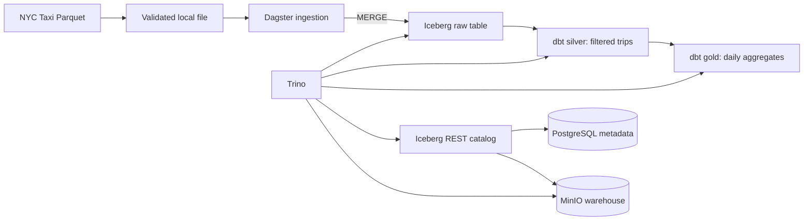

# Local Lakehouse Pipeline

A local data engineering project that ingests the first 10,000 occurrences from a January 2024 NYC yellow taxi Parquet delivery into Iceberg, then builds filtered trip records and daily aggregates with dbt. It explores the boundary between object storage, a metadata catalog, SQL execution and orchestration without relying on a managed lakehouse service.



Dagster coordinates assets; Trino queries Iceberg tables stored as Parquet in MinIO. The Iceberg REST catalog uses PostgreSQL for catalog metadata. dbt builds the Silver and Gold models and runs data-quality checks. Python dependencies are locked with uv.

## Correctness and boundaries

The acquisition step validates the Parquet schema, samples each row group and publishes a downloaded file atomically without overwriting an existing cache. SHA-256 identifies the observed file; it does not prove source authenticity. Ingestion uses the file hash and absolute zero-based source row number as provenance and performs insert-only batch MERGE operations. Ordered replays of the same file skip existing keys; identical rows at different positions remain distinct. A failed batch can be retried with the same file.

The current contract supports one immutable January 2024 delivery and the first 10,000 rows. Writers must be serialized externally: Iceberg does not enforce provenance-key uniqueness. Batch commits are not one transaction; failures can leave a partial load. Schema and provenance preflight rejects incompatible existing tables rather than migrating them. See [data-quality tests](dbt_project/tests/README.md) for reconciliation limits.

## Explore without infrastructure

Use Linux/WSL, Python 3.12 and uv 0.13.6. Installation needs network access or a populated cache. From the repository root:

```bash
uv sync --locked --python 3.12
env -u RUN_TRINO_ICEBERG_TESTS uv run --no-sync python -W error -m unittest discover -s tests -v
DBT_SEND_ANONYMOUS_USAGE_STATS=false uv run --no-sync dbt parse --project-dir dbt_project --profiles-dir lakehouse_pipeline/trino
DBT_SEND_ANONYMOUS_USAGE_STATS=false uv run --no-sync dbt ls --project-dir dbt_project --profiles-dir lakehouse_pipeline/trino --target local_acceptance --resource-type test --output name
```

The offline tests use generated synthetic records and fake cursors to demonstrate replay, duplicates, partial failure and validation. They do not require Docker, credentials or a live database. dbt discovery finds 11 reusable tests; adding `--vars '{dq_local_acceptance: true}'` enables a twelfth, single-file acceptance check. Discovery does not execute SQL. Four separate live integration cases are skipped by default; see [integration safety instructions](tests/integration/README.md).

For a safe synthetic demonstration, run the offline suite above and inspect `tests/test_ingestion_idempotency.py`: its generated duplicate rows and simulated partial failures show how provenance and retries behave, with no dataset download or infrastructure mutation.

## Running the local stack

Read [development and deployment guidance](docs/DEVELOPMENT.md) before starting or changing services. Provision the required values privately using the empty [.env.example](.env.example); do not put credentials in Git. Compose supplies MinIO, PostgreSQL, REST catalog and Trino; Dagster is host-launched. Run dbt parse before importing Dagster definitions in a clean checkout. The Dagster full pipeline downloads real public taxi data and writes tables; use a disposable, explicitly approved environment for a live demonstration.

## Verified outcomes and evidence boundaries

| Evidence | Result | What it establishes |
| --- | --- | --- |
| Offline Python suite | 70 PASS; four live write tests skipped | Synthetic acquisition, serialization, replay and failure/retry contracts; no services or credentials. |
| Offline dbt | 11 reusable tests / 12 with acceptance enabled | Parsing, compilation, discovery and schema routing; no SQL execution. |
| Dagster source validation | Five assets, ingestion/full jobs and lineage validated | Definitions and dependencies load; no materialization. |
| Controlled operational acceptance, 2026-11-06 | Raw 10,000; Silver 9,737; Gold 2; 12 dbt PASS | Existing sample tables reconciled in a separately operated local deployment. |
| Operational security recovery, 2026-11-06 | A and B complete | Exposed MinIO/S3 and PostgreSQL credentials rejected; replacement consumers worked; anonymous warehouse access denied. |

The operational checks also verified 204 unchanged object hashes, 11 readable
Iceberg tables and preserved Dagster history. They are historical evidence from
a separate deployment, not a fresh end-to-end run of this checkout. No full
Dagster materialization ran during that security verification. The four gated
write integration tests remain unexecuted; their simulations and the read-only
dbt acceptance suite are different checks. Private recovery records are excluded.

This repository has independent, source-only commit ancestry; original Git
history, credentials, runtime databases and datasets are excluded. See
[release evidence](docs/RELEASE_READINESS.md) for current local checks, dedicated
Gitleaks scans and the distinction between initial and final-commit hosted CI.

## Security and operational limits

Host ports bind loopback, while containers share an HTTP network. REST and Trino
frontend authentication is not configured. The existing catalog database role
retains elevated privileges, and operational backups are local and unencrypted.
These limitations are disclosed, not resolved by publishing source. Use an
isolated development machine; the project is not production-ready.

The deployment template requires empty-by-default external credentials and does
not provision IAM users. It passes one non-root warehouse S3 pair to its clients;
the separately hardened operational deployment uses independent scoped consumer
identities. Do not infer that its private runtime configuration is included here.
Initialization creates a missing bucket without granting anonymous access and
does not revoke policies already persisted in an existing installation. Read
[security guidance](docs/SECURITY.md) before any live deployment.

Only the first 10,000 ordered source occurrences are ingested. Acquisition and
the current reader can still download/read the complete monthly Parquet file.
Full-month ingestion, production-scale performance and general concurrent-writer
safety are unverified. Writers must be serialized; batch commits are separate,
and failures can leave a partial load until replay. SHA-256 identifies observed
bytes; sampled Parquet validation does not prove upstream authenticity or decode
every data page.

## Tradeoffs and next steps

The design favors transparent SQL and replayable batches over parallel ingestion and multi-file versioning. Offline mocks exercise the client contract but cannot prove Iceberg concurrency, runtime authentication or deployed service health. Future template work includes per-consumer IAM provisioning, authenticated service transport, immutable image digests, automated deployment acceptance and a reviewed multi-delivery ingestion policy. Independent scoped identities and pinned images were verified in the separate operational recovery; they are not automatically reproduced by this template.

The latest [verification evidence and release gates](docs/RELEASE_READINESS.md) distinguish offline results from pending infrastructure checks.


For a concise walkthrough, see [the synthetic demo](docs/DEVELOPMENT.md#synthetic-demo).
[Verification and release gates](docs/RELEASE_READINESS.md), the
[publication manifest](PUBLICATION_MANIFEST.json), and
[CV project bullets](docs/PORTFOLIO.md) accompany the candidate.

## Source, attribution and license

Project code and documentation use the [MIT license](LICENSE), with the retained
2026 James copyright notice. The owner confirmed publication rights and public
commit-author metadata disclosure on 2026-11-08. Third-party tools and dependencies
remain under their own licenses; this repository does not vendor their source.
The architecture diagram is Mermaid source describing this implementation.

Runtime input comes from the [NYC TLC Trip Record Data page](https://www.nyc.gov/site/tlc/about/tlc-trip-record-data.page),
specifically the January 2024 Yellow Taxi Parquet delivery. No taxi records,
Parquet files, map images or other external dataset assets are redistributed.
The source-code MIT license does not assign rights to upstream data. Review
upstream notices and terms for any later data redistribution.
