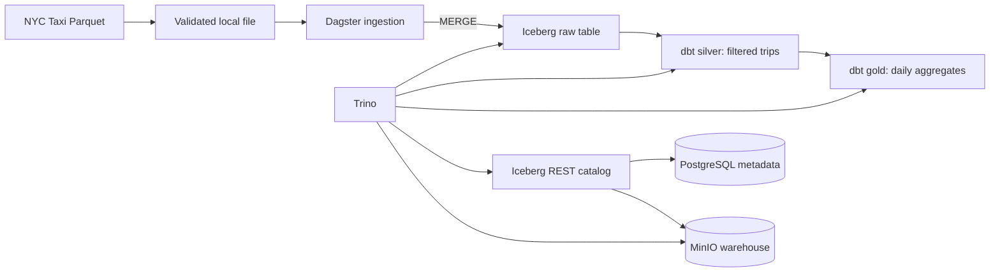

# Local Lakehouse Pipeline

A local data engineering project that ingests a January 2024 NYC yellow taxi Parquet delivery into an Iceberg table, then builds filtered trip records and daily aggregates with dbt. It explores the boundary between object storage, a metadata catalog, SQL execution and orchestration without relying on a managed lakehouse service.



Dagster coordinates assets; Trino queries Iceberg tables stored as Parquet in MinIO. The Iceberg REST catalog uses PostgreSQL for catalog metadata. dbt builds the Silver and Gold models and runs data-quality checks. Python dependencies are locked with uv.

## Correctness and boundaries

The acquisition step validates the Parquet schema, samples each row group and publishes a downloaded file atomically without overwriting an existing cache. SHA-256 identifies the observed file; it does not prove source authenticity. Ingestion uses the file hash and absolute zero-based source row number as provenance and performs insert-only batch MERGE operations. Ordered replays of the same file skip existing keys; identical rows at different positions remain distinct. A failed batch can be retried with the same file.

The current contract supports one immutable January 2024 delivery and the first 10,000 rows. Writers must be serialized externally: Iceberg does not enforce provenance-key uniqueness. Batch commits are not one transaction; failures can leave a partial load. Schema and provenance preflight rejects incompatible existing tables rather than migrating them. See [data-quality tests](dbt_project/tests/README.md) for reconciliation limits.

## Explore without infrastructure

Use Linux/WSL, Python 3.12 and uv 0.13.6. Installation needs network access or a populated cache. From the repository root:

```bash
uv sync --locked --python 3.12
env -u RUN_TRINO_ICEBERG_TESTS uv run --no-sync python -W error -m unittest discover -s tests -v
DBT_SEND_ANONYMOUS_USAGE_STATS=false uv run --no-sync dbt parse --project-dir dbt_project --profiles-dir lakehouse_pipeline/trino
DBT_SEND_ANONYMOUS_USAGE_STATS=false uv run --no-sync dbt ls --project-dir dbt_project --profiles-dir lakehouse_pipeline/trino --target local_acceptance --resource-type test --output name
```

The offline tests use generated synthetic records and fake cursors to demonstrate replay, duplicates, partial failure and validation. They do not require Docker, credentials or a live database. dbt discovery finds 11 reusable tests; adding `--vars '{dq_local_acceptance: true}'` enables a twelfth, single-file acceptance check. Discovery does not execute SQL. Four separate live integration cases are skipped by default; see [integration safety instructions](tests/integration/README.md).

For a safe synthetic demonstration, run the offline suite above and inspect `tests/test_ingestion_idempotency.py`: its generated duplicate rows and simulated partial failures show how provenance and retries behave, with no dataset download or infrastructure mutation.

## Running the local stack

Read [development and deployment guidance](docs/DEVELOPMENT.md) before starting or changing services. Provision the required values privately using the empty [.env.example](.env.example); do not put credentials in Git. Compose supplies MinIO, PostgreSQL, REST catalog and Trino; Dagster is host-launched. Run dbt parse before importing Dagster definitions in a clean checkout. The Dagster full pipeline downloads real public taxi data and writes tables; use a disposable, explicitly approved environment for a live demonstration.

## Security and verification status

This source-only candidate contains no Git history, credentials or datasets.
Offline verification exercises code contracts; it does not establish production
security or live service health. Host ports bind loopback, but containers share a
network and Trino/REST use internal HTTP without client authentication. Use an
isolated development machine. Do not expose this stack to an untrusted network.

Credentials are required external inputs. Initialization creates a missing bucket
without adding public access; it does not revoke a policy persisted by an existing
deployment. Existing installations require backed-up, explicitly authorized
activation and access verification. See [security guidance](docs/SECURITY.md).
Prior credential exposure response remains an operator gate before publication.

## Tradeoffs and next steps

The design favors transparent SQL and replayable batches over parallel ingestion and multi-file versioning. Offline mocks exercise the client contract but cannot prove Iceberg concurrency, runtime authentication or deployed service health. Future work includes scoped service identities, authenticated service transport, immutable image digests, automated deployment acceptance, serialized writers, and a reviewed multi-delivery ingestion policy.

The latest [verification evidence and release gates](docs/RELEASE_READINESS.md) distinguish offline results from pending infrastructure checks.


For a concise walkthrough, see [the synthetic demo](docs/DEVELOPMENT.md#synthetic-demo).
[Verification and release gates](docs/RELEASE_READINESS.md), the
[publication manifest](PUBLICATION_MANIFEST.json), and
[CV project bullets](docs/PORTFOLIO.md) accompany the candidate.
